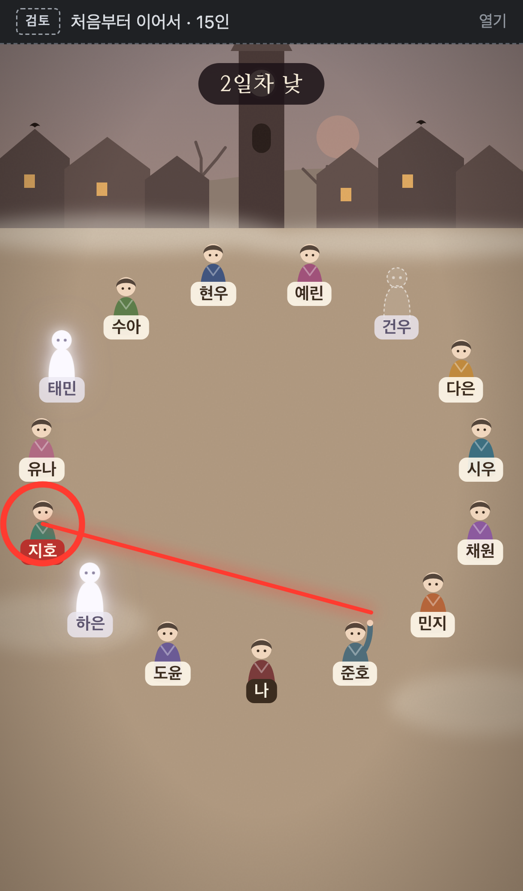
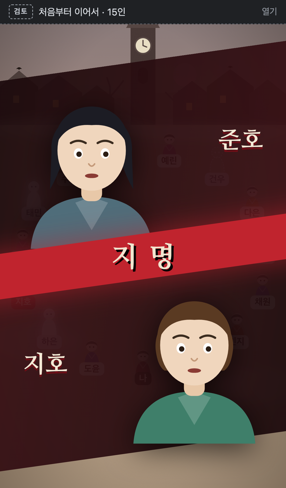
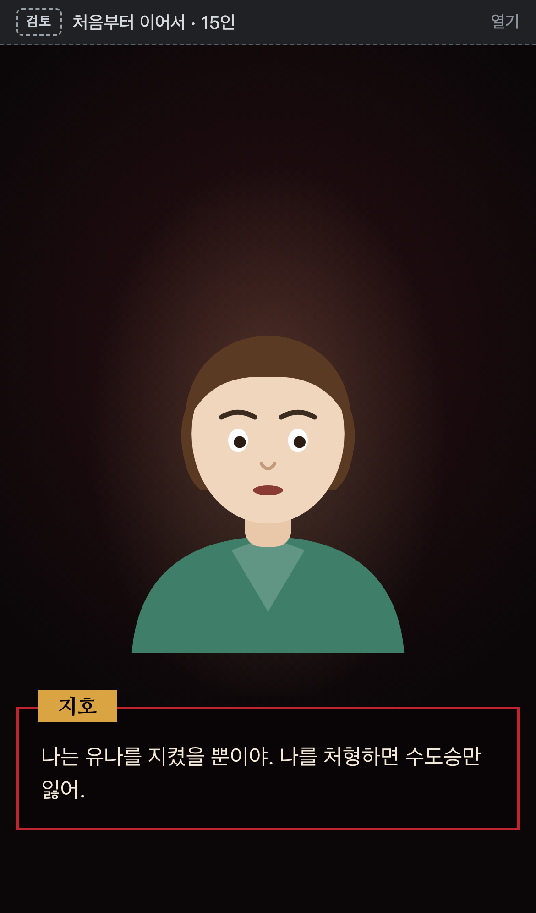
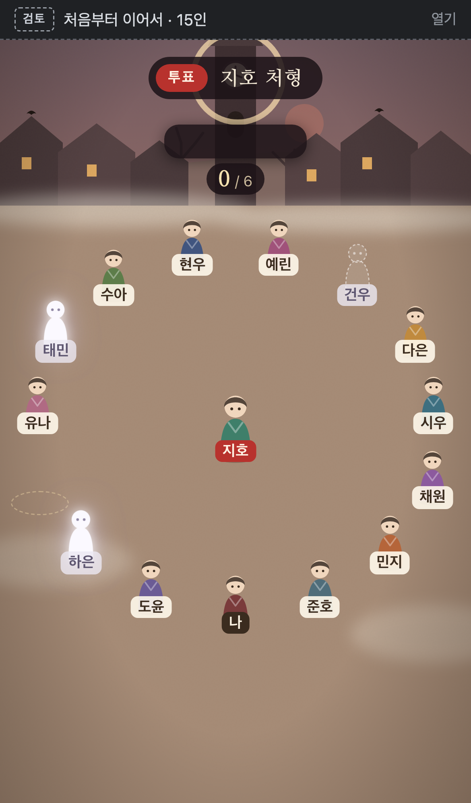
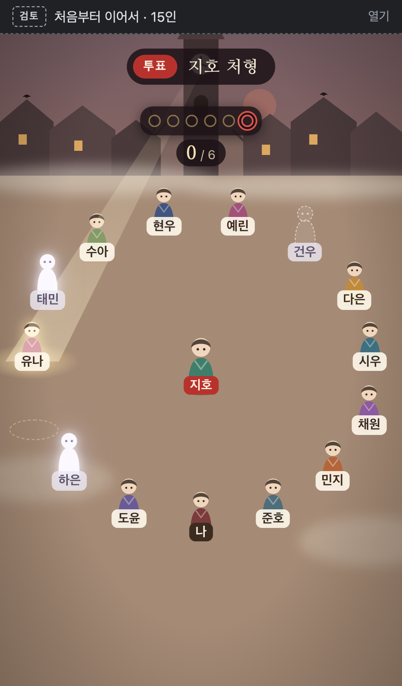
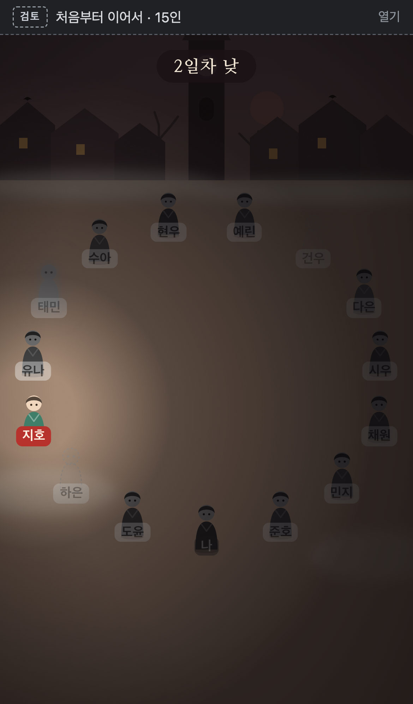
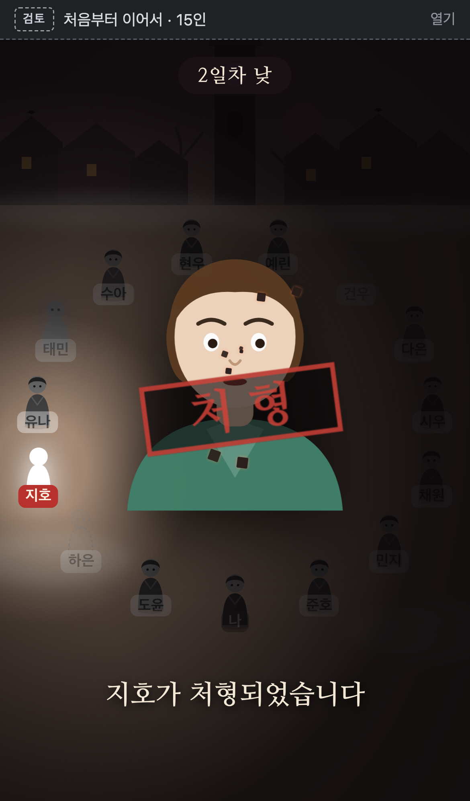
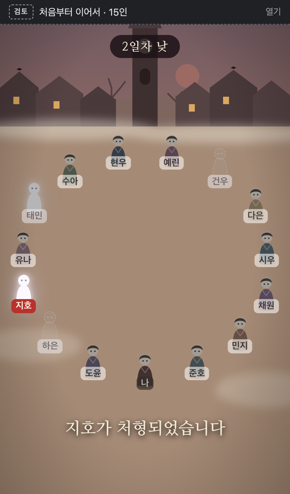
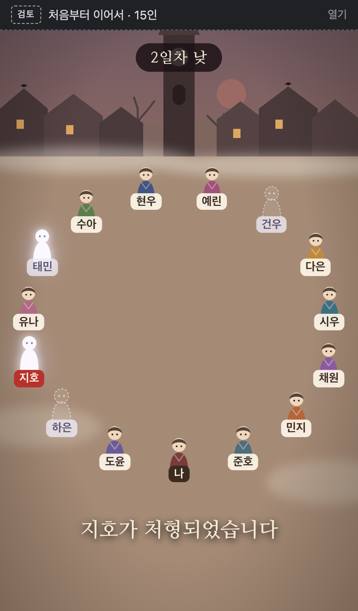
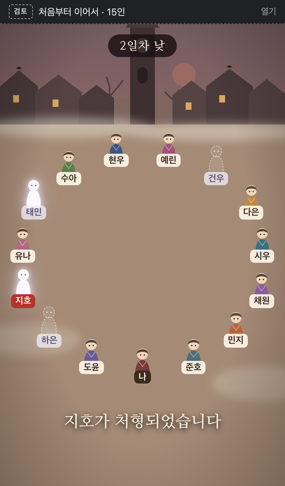

# 이슈 294 장면 전환 인계

2026-10-12 사용자 평가: **"전환효과 좋다."** 이 문서는 전환 시안을 검토 10(`web/issue-294-tribunal.html`)의 실제 흐름에 옮겨 붙일 작업자를 위한 기록이다. 최신 방향과 남은 범위는 [이슈 #294 설계 댓글](https://github.com/metishonora/clocktower/issues/294#issuecomment-5934051761)을 따른다.

- 시안: `web/issue-294-flow.html` (커밋 `f786ece`). 검토 막대에서 ①·④·⑥을 따로 재생할 수 있다.
- 코드: `web/src/prototypes/issue294/Flow.tsx`, `flow.css`, `flowMain.tsx`
- 프로토타입 브랜치 `claude/issue-294`는 `develop`에 머지하지 않는다.

## 목표와 원칙

검토 10은 장면을 검은 배경 위에서 0.35초 페이드로 갈아 끼운다. 그래서 광장, 컷인, 증언대, 투표가 서로 다른 화면처럼 끊긴다. 전환 시안은 다음 세 원칙으로 이를 잇는다. 옮길 때도 이 원칙을 지킨다.

1. **앞 장면의 무언가를 다음 장면으로 들고 간다(매치 컷).** 광장의 인물이 그 자리에서 커져 컷인 초상화가 되고, 증언대는 지명된 사람에게로 줄어들며 광장이 드러난다.
2. **결정적 순간에만 멈춘다.** 지명, 처형 선 돌파, 처형 확정에서만 짧게 멈추고(히트스톱) 섬광·흔들림을 준다. 나머지 전환은 1초 안팎이다.
3. **광장은 항상 뒤에 살아 있다.** 재판정은 광장 위에 내려오는 막이고, 끝나면 걷혀서 같은 광장으로 돌아온다. 검은 화면을 거치지 않는다.

## 전환별 동작과 시간

시간은 시안 기준값이다. 실제 리듬은 기기에서 보고 조정해도 된다.

| 전환 | 단계 | 시간 | 동작 |
| --- | --- | --- | --- |
| **① 광장 → 지명** | point | 1.3초 | 지명한 사람이 손을 들고, 그 손끝에서 붉은 선이 광장을 가로질러 지명된 사람에게 꽂힌다(선 0.45초). 지명된 사람에게 붉은 조준 원이 조여 든다. 지명된 사람 이름표가 붉게 바뀐다. |
| | hit | 0.3초 | 지명된 사람을 중심으로 붉은 섬광. 두 사람 외 인물·이름표가 흑백으로 바랜다. |
| | zoom | 0.9초 | 두 사람의 초상화가 **각자의 머리 위치에서** 출발해 컷인 띠 위치로 커지며 날아간다. 띠는 양옆에서 들어오고 반투명이라 광장이 비친다. |
| | cutin | 1.7초 | 이름, "지명" 칼띠. |
| **② 컷인 → 지명 이유** | testimony 진입 | 0.45초 | 증언대가 가운데 선에서 위아래로 열리며 나타난다(`fl-split-in`, 칼띠와 같은 높이에서 열림). |
| **④ 증언대 → 광장 투표** | pullback | 1.5초 | 증언대 층이 지명된 사람의 광장 위치로 줄어들며 사라진다(`fl-shrink`). 동시에 광장 층이 같은 지점을 기준으로 1.7배에서 1배로 빠지며, 붉게 가라앉은 색에서 원래 색으로 돌아온다(`fl-pull`). 지명된 사람은 제자리에서 광장 가운데로 걸어 나온다(0.9초). |
| | bell | 1.3초 | 시계탑에서 종 물결 3개. 표 슬롯이 위에서 하나씩 떨어져 자리 잡는다(0.07초 간격). 지명된 사람의 빈 자리에 점선 원. |
| | sweep | 자리당 | 빛줄기가 지명된 사람 자리부터 시계방향으로 돈다. 표가 **처형 선을 넘는 순간** 0.4초 화면 흔들림 + 붉은 맥동(⑤). |
| | result | 1.9초 | 지명된 사람이 제자리로 돌아가고 결과창이 광장 가운데로 내려온다(이미 `VoteLab.tsx`에 반영됨). |
| **⑥ 광장 위 처형** | confirm | 1.0초 | 이야기꾼 확정 신호에 맞춰 빛이 지명된 사람에게 모이고 나머지가 어두워진다(원형 마스크). |
| | rise | 1.0초 | 지명된 사람 머리 위에서 초상화가 떠올라 화면 가운데로 커진다. |
| | stamp | 1.3초 | "처형" 도장이 크게 찍힌다. 결과 문구가 나타난다. |
| | ash | 1.9초 | 초상화가 흐려지며 재·불씨 입자로 흩어진다. 그 자리의 인물이 빛나는 유령으로 바뀐다. 광장이 다시 밝아진다. |

장면 순서 전체는 `Flow.tsx`의 `phases`와 `durations`에 있다.

| 지명 · ① | 컷인 | 증언대 | ④ 빠지는 중 | 투표 진행 | 처형 선 돌파 |
| --- | --- | --- | --- | --- | --- |
|  |  |  |  |  |  |

| ⑥ 빛이 모임 | 도장 | 재로 흩어짐 | 끝 |
| --- | --- | --- | --- |
|  |  |  |  |

## 검토 10에 옮길 때의 구조

현재 검토 10의 구조와 바꿀 점이다.

1. **광장을 가리지 않는다.** `speaking.tsx`의 `tb-world.is-covered`(`visibility: hidden`)와 `.tb-scene`의 불투명 검은 배경 때문에 장면 사이에 검은 화면이 생긴다. 광장 층은 항상 그리고, 재판정 장면은 그 위에 겹치는 층으로 바꾼다. 입력 차단(`inert`)은 유지한다.
2. **장면 상태에 전환 단계를 둔다.** `TribunalReview.tsx`의 `Scene`에 전환 단계를 추가하거나(`point`, `hit`, `pullback`, `bell`, `confirm`, `rise`, `stamp`, `ash`), 장면마다 "진입 중/머무름" 하위 상태를 둔다. 자동 재생 시간표(`next`)도 위 표에 맞춘다.
3. **좌표는 광장 배치에서 가져온다.** 초상화 출발점, 증언대가 줄어드는 지점, 빛이 모이는 지점은 모두 광장 인물 위치다. `Flow.tsx`의 `toPx`, `head(seat)`, `backdropPoint`(시계탑 위치)를 공용 함수로 옮겨, 광장(`SpeakingPlaza`·`PlazaVote`)과 재판정(`Trial`)이 같은 좌표를 쓰게 한다.
4. **컷인(`Trial`의 `cutin`)은 출발 좌표를 받는다.** 지금은 띠가 화면 밖에서 들어온다. 두 초상화가 받은 출발 좌표에서 띠 위치로 날아가도록 바꾸고, 띠 배경은 반투명으로 한다.
5. **투표는 종이 울린 뒤 시작한다.** `PlazaVote`는 진입 1.5초 뒤 빛을 켠다. bell 단계가 끝난 시점에 시작하도록 맞추고, 슬롯이 떨어지는 연출을 집계 표에 넣는다. 처형 선 돌파 연출(`crit`)도 `PlazaVote`에 옮긴다.
6. **처형은 광장 위에서 한다.** 지금 `NightPlaza`가 `Trial`의 `verdict`를 겹쳐 처형을 보여 준다. 처형은 광장 층에서 ⑥으로 처리하고, 끝나면 `NightPlaza`의 밤 전환(`falling`)으로 이어지게 한다. 처형 장면의 도장·문구는 `Trial`의 `Verdict` 스타일을 재사용해도 된다.

재사용할 수 있는 시안 부품(`Flow.tsx`·`flow.css`):

- `Ash`(재·불씨 입자), 지명 선 SVG(`fl-accuse`), 섬광(`fl-flash`), 종 물결(`fl-bell`), 빛 모임 마스크(`fl-converge`)
- 키프레임: `fl-pull`, `fl-shrink`, `fl-split-in`, `fl-draw`, `fl-target`, `fl-drop`, `fl-crit`, `fl-shake`, `fl-stamp`, `fl-dissolve`, `fl-ash`, `fl-rise-ghost`

시안 전용이라 버릴 것: `flowMain.tsx`(검토 셸), 요약 증언대(`fl-trial`), 빠른 관전 투표(`sweep` 진행 로직). 실제 증언대와 투표는 검토 10의 `Trial`·`PlazaVote`를 쓴다.

## 지켜야 할 것

- **공개 사건만 연출한다.** ①·④·⑥은 모두 공개 사건이라 모든 참가자에게 같게 보여도 된다. 개인 정보와 연결하지 않는다.
- **반복은 짧게.** 같은 날 두 번째 지명부터 ①·④는 절반 길이로 줄인다(예: 히트스톱과 카메라 빠짐 생략).
- **늦게 들어온 사람은 연출을 건너뛴다.** 재접속하거나 늦게 연 참가자는 진행 중인 전환을 보지 않고 현재 장면의 최종 상태로 바로 들어간다(#286 요구).
- **움직임 줄이기 설정**(`prefers-reduced-motion`)에서는 모든 전환을 즉시 또는 짧은 크로스페이드로 대체한다. 시안의 `flow.css` 마지막 규칙을 참고한다.
- **전환 중 입력.** 투표 버튼은 bell 단계가 끝난 뒤 켠다. 전환 도중 받은 귓속말·공지는 전환이 끝난 뒤 알린다.

## 시안이라 대강 둔 점

- 지명할 때 손을 드는 동작은 투표용 "한 손 들기"를 재사용했다. 가리키는 손 모양은 다듬어도 된다.
- 초상화는 재판정 시안의 SVG 얼굴이다. 최종 그림은 #285에서 정한다.
- 시간값과 이징은 근사치다. 기기에서 확인하며 조정한다.
- 8인에서도 동작하지만 15인 위주로 다듬었다. 지명한 사람과 지명된 사람이 이웃이면 지명 선이 짧아지니, 선의 최소 길이나 곡선 처리를 검토한다.

## 건의가 필요한 경계

- 위 세 원칙(매치 컷, 결정적 순간만 정지, 광장 유지)을 바꾸는 경우
- 처형을 광장이 아닌 별도 화면으로 되돌리는 경우
- 전환 중 참가자 입력(투표·대화)을 막거나 허용하는 범위를 바꾸는 경우. 이는 #283·#290과 연결된다.

## 확인 방법

- 15인·8인 휴대폰 크기에서 각 단계의 대표 장면을 스크린샷으로 확인한다. 특히 ④의 빠지는 중간 장면과 ⑥의 도장 장면에서 겹침이 없는지 본다.
- 헤드리스 스크린샷은 큰 `filter`·`transform` 애니메이션 도중 빈 화면으로 찍히는 경우가 있다. 한 번 더 찍어 실제 문제인지 확인한다.
- 루트 요소에 단계 이름을 클래스로 붙일 때 기존 부품 클래스와 겹치지 않게 접두사를 쓴다. 시안에서 `fl-stamp`·`fl-ash`가 루트 클래스와 겹쳐 화면 전체가 도장처럼 기울어지는 문제가 있었다(`fl-p-${phase}`로 해결).
- `pnpm --dir web build`가 통과해야 한다.
